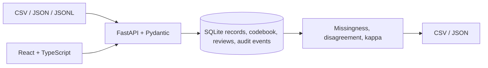

# Architecture

The API owns validation and state transitions. Import parsers normalize supported formats into validated records; the service checks duplicates and codebook labels before persisting. Annotation, second-review, adjudication, and correction events retain reviewer IDs and timestamps. Quality metrics derive from stored annotations and include the number of records used. The gold-label file is kept separate from the blind annotation records to avoid leaking expected labels into the review workflow.

SQLite is appropriate for a single-user local demo. Authentication, true role authorization, concurrent multi-user operation, migrations, and production backup/retention are outside the current implementation.
